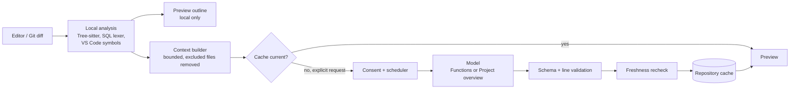

# How Downside Up works

A short tour of the extension's architecture for developers and technical
evaluators. For usage, see the [README](../README.md); for setup, conventions,
and releases, see [development.md](development.md). The complete behavioral
and privacy contract, including every limit and edge case, is
[prototype.md](prototype.md); where this page and the contract differ, the
contract wins.

## The big picture

Local analysis decides **what** a model sees; the model only writes the
plain-language text; the host validates, caches, and links that text back to
source it found itself.

Nothing to the right of the cache check runs unless the user asks (or has
opted into prefetch); see [Requests and privacy](#requests-and-privacy).

## Source map

| Area | Where |
|---|---|
| Activation, commands, preview wiring | [`src/extension.ts`](../src/extension.ts) |
| Generation service (explain, prime, summarize, compare) | [`src/controller.ts`](../src/controller.ts) |
| Language contract and registry | [`src/languages/support.ts`](../src/languages/support.ts), [`src/languages/registry.ts`](../src/languages/registry.ts) |
| Per-language analysis | `src/languages/<language>/` (`editor/` for languages without bundled support) |
| Repository scan and exclusions | [`src/context/inventory.ts`](../src/context/inventory.ts), [`src/context/policy.ts`](../src/context/policy.ts) |
| Function context | [`src/context/related.ts`](../src/context/related.ts) |
| Prompts, providers, response parsing | [`src/generation/`](../src/generation/) |
| Cache, freshness, consent | [`src/cache/`](../src/cache/) |
| Preview, scheduler, prefetch, export | [`src/presentation/`](../src/presentation/) |
| Change view and review mode | [`src/changeSession.ts`](../src/changeSession.ts), [`src/review.ts`](../src/review.ts), [`src/context/comparison.ts`](../src/context/comparison.ts) |
| PR publication | [`src/github/`](../src/github/) |

## 1. Local analysis

Each language is one `LanguageSupport` object in its own folder, listed in the
registry; the rest of the extension asks the registry and never checks
languages itself.

| Language | Discovery | Related code |
|---|---|---|
| Rust, Go, Python | Bundled Tree-sitter WASM | Bundled static resolution |
| JavaScript, TypeScript, React | Bundled Tree-sitter WASM | VS Code's built-in TypeScript go-to-definition |
| SQL | Bundled bounded lexer | Static lookup in eligible `.sql` files |
| Others | VS Code document symbols | VS Code go-to-definition, if installed |

No language server is assumed for the bundled languages. The hooks, and
whether their output can reach a model:

| Hook | Purpose | Sent to a model? |
|---|---|---|
| `findFunction`, `listFunctions` | Function boundaries, qualified names, identities | Yes: the function's source, and names in outlines and folder catalogs |
| `preamble` | The file's imports and declarations | Yes, with every function of the file |
| `findDependencies` | Items the function uses | Yes: bodies at depth 1, signatures at depth 2 |
| `explanationGuidance` | Fixed background for a kind of function (such as React components) | Yes; extension-authored text only, never repository text |
| `comparisonFunctions` | Exact-snapshot inventory for diffs | Yes: host-issued ids for Added/Changed/Removed |
| `fileImports` | Import edges for structure diagrams | Edge names in folder summary and flow requests |
| `describeSource` | Plain-language outline in the preview | **No**, display only |
| `textFingerprint` | Formatting-tolerant evidence | **No**, cache freshness only |
| `findDirectCalls` | Fallback caller lookup | **No**, navigation only |

## 2. Building context

**Repository priming.** The first generation in a repository runs a bounded
scan ([`gatherInventory`](../src/context/inventory.ts)): at most 2,000
eligible files, ranked so READMEs, manifests, API contracts, deployment
files, and entry points come first. Up to 64 KiB of that text, a symbol
outline, and a folder outline go to the Project overview model, which
returns the repository overview and the project map. Deployment files are
reduced to names (`deploymentFacts`), never values.

**Function context** ([`gatherFunctionContext`](../src/context/related.ts)):

- the function's source with numbered lines (sent once);
- its file's preamble;
- depth 1: types, functions, and methods it uses directly, whole up to
  4 KiB each and 16 KiB in total, else signature only;
- depth 2: signatures of functions those call (at most 12, 4 KiB);
- the repository overview as background, and language guidance if any.

Every snippet is labelled with its file and kind. Each included item is
recorded as a tracked input with its depth and whether it was whole or a
signature, so freshness later matches exactly what the model saw.

**Bounds.** Requests are capped by `downsideUp.maxRequestSize` (default
96 KiB) and priming by `downsideUp.maxProjectContextRequestSize` (default
256 KiB), measured on the serialized request, plus the model's own token
limit. Oversized requests fail before sending. Large diffs switch to a
diff-first excerpt with up to two bounded same-file follow-ups.

## 3. Models

Two roles, each chosen in the preview header:

| Role | Setting | Handles |
|---|---|---|
| **Functions** | `languageModel.model` / `openai.model` | Function explanations, added Pseudocode/Flowchart views, file summaries, per-file change comparisons |
| **Project overview** | `languageModel.overviewModel` / `openai.overviewModel` (falls back to Functions) | Repository overview and project map, folder summaries, main flows, review summaries |

Providers ([`src/generation/`](../src/generation/)) are the VS Code Language
Model API (`vscode-lm`; Copilot or any extension model, using the user's
subscription) and OpenAI's Responses API (key in SecretStorage,
`store:false`). There is no fallback between providers; production starts
unconfigured, and the mock provider exists only in development and test hosts.

## 4. Validating model output

Model output is untrusted. Before anything is shown or saved:

- responses are parsed against a schema
  ([`schema.ts`](../src/generation/schema.ts)); unusable responses fail
  generically, with no automatic retry;
- step, pseudocode, and flowchart line references are clamped to the function
  and re-anchored by the text of their first line
  ([`stepLines.ts`](../src/presentation/stepLines.ts)); unresolvable ones are
  left unlinked;
- flowcharts are structurally checked (at most 24 nodes and 40 edges, known
  endpoints, bounded nesting); an invalid chart is dropped with a limitation;
- project maps, flows, and review summaries keep only parts, files,
  functions, and ids the host already knows
  ([`checkedProjectMap`](../src/context/projectMap.ts));
- all navigation uses host-issued references; the webview renders generated
  content as text, under a restrictive content-security policy.

## 5. Caching and freshness

Records live in VS Code global storage, outside the repository, as one
`cache.json` per repository ([`store.ts`](../src/cache/store.ts)). It holds
the overview, project map, explanations, file and folder summaries, flows,
change comparisons, review summaries, token usage, and per-model consent.

- **Keys** combine the function's identity (not its line numbers), provider,
  model, explanation settings, and prompt version
  ([`freshness.ts`](../src/cache/freshness.ts)).
- **Current** means the recorded tracked inputs still match: the function,
  its file's imports, depth-1 items, and depth-2 signatures. Fingerprints
  ignore formatting where the language allows it; edits elsewhere do not
  outdate a record.
- **Outdated** records stay visible, marked amber, and are regenerated only on
  request. Invalidation never triggers generation.
- **Overview staleness** is separate: repository changes make the overview
  due for a bounded review on the next generation, without outdating saved
  explanations.
- **In-flight safety:** before saving, the service gathers context again and
  rejects the result if tracked inputs, exclusions, trust, or the model
  changed, or the cache was cleared. Writes are atomic (temporary file, then
  rename), with a final validation hook just before the rename.
- **Versioning:** prompt and schema versions are bumped whenever a format
  changes; old records are simply not reused, not migrated.

## 6. Requests and privacy

- **Explicit requests only.** Opening files, cursor movement, hovering,
  editing, and cache misses only read the cache. Generation comes from
  **Explain**, **Explain changes**, a confirmed review, opening an unmapped
  project page, an explicit refresh, or opt-in prefetch (user setting, never
  prompts, uses only consent already given).
- **Consent** is per repository and per model
  ([`consent.ts`](../src/cache/consent.ts)), in a trusted workspace, before
  anything is sent.
- **Exclusions** ([`sharingExclusion`](../src/context/inventory.ts)):
  `.gitignore`, `.copilotignore`, VS Code exclusions, secret-like, generated,
  and vendored files, and optional organization policy files read from user
  settings only. They apply to the scan and to the explained file itself, and
  are rechecked right before dispatch. GitHub Copilot's server-side content
  exclusion does not apply to Language Model API requests.
- **Scheduling** ([`RequestScheduler`](../src/presentation/requestScheduler.ts)):
  up to `downsideUp.maxConcurrentRequests` at once; explicit requests start
  before prefetch, which never takes the last slot. Overview priming is
  exclusive per repository, so parallel explanations share one overview and
  one consent prompt.
- **Secrets** stay in SecretStorage; PR publishing uses the existing `gh`
  login and stores no GitHub token.

## Life of an explanation

What [`ExplanationService.explain`](../src/controller.ts) does when the user
presses **Explain**:

1. Check the model is configured, the file is not excluded, and the cache was
   not cleared since the request began.
2. Scan the repository (bounded), add the symbol outline, and gather the
   function's context; fail early if it exceeds the request size.
3. If a current explanation exists, return it without touching the overview.
4. Otherwise prime or review the overview if it is missing, from another
   model, or due for review (exclusive per repository).
5. Ask for consent if this repository and model are not approved; recheck
   trust, model, and exclusions just before sending.
6. Send the prompt to the Functions model; parse and validate the response
   and normalize its source lines.
7. Re-gather context and reject the result if tracked inputs changed.
8. Save atomically, recording inputs, model, prompt version, and usage.
9. If the file has no current summary, request one through the same
   scheduler and consent.

## Extending

- **New language:** add `src/languages/<language>/` exporting one
  `LanguageSupport`, register it in `registry.ts`, and for a Tree-sitter
  grammar add it to `esbuild.config.mjs`. Keep all language checks there.
- **New generated content:** add a prompt and parser in `src/generation/`, a
  versioned cache record with recorded inputs, a host-side validation step,
  and an explicit trigger; update [prototype.md](prototype.md) and the README.
- See [development.md](development.md#verification) for the test layers.
